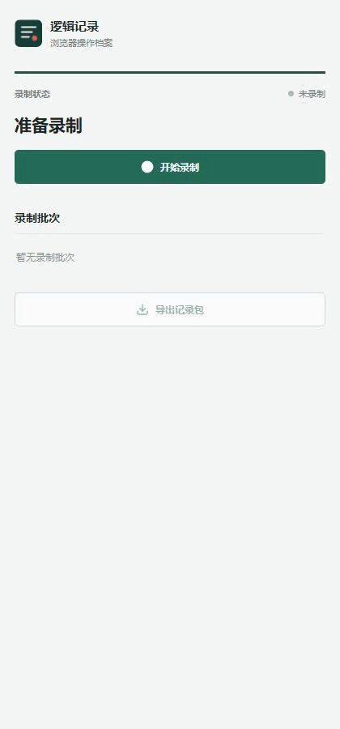
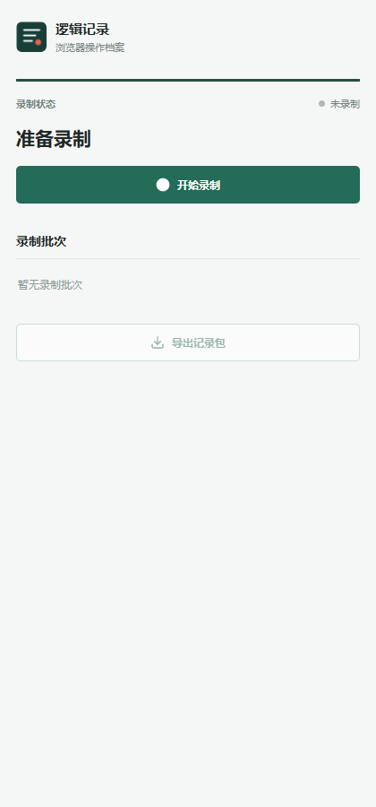
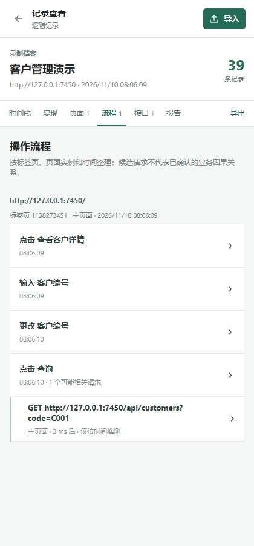
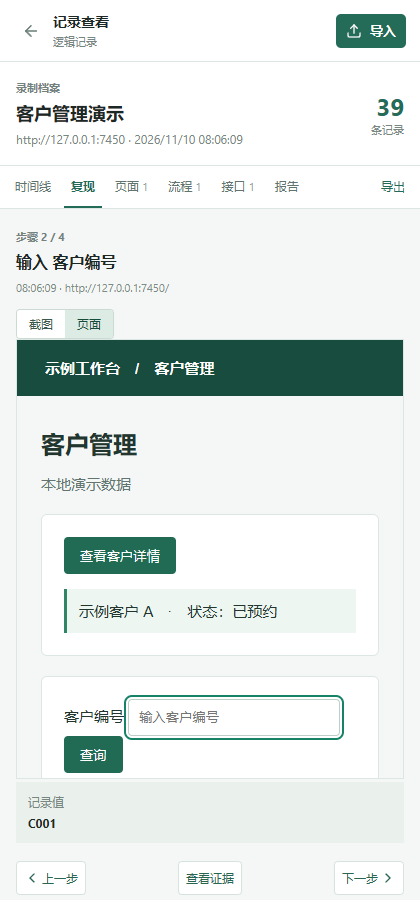

# Logic Recorder

**Record authorized web workflows from a Chrome side panel and package the observed pages, requests, and state as a shareable local archive.**

[中文](README.md) · [Installation and usage (Chinese)](docs/插件安装与使用说明.md) · [Technical design (Chinese)](docs/Chrome扩展技术开发文档.md) · [Requirements (Chinese)](docs/Chrome扩展需求梳理.md) · [Changelog](docs/CHANGELOG.md)

> Version **0.1.0 is a development preview**. It records paths the user actually visits. It cannot guarantee capture of every browser event, recover unvisited branches, or automatically reconstruct the original site's source code and server logic. Read [Limitations](#limitations) and [Data and privacy](#data-and-privacy) before use. The current extension interface is in Chinese.

## Demo



[Watch MP4](docs/media/workflow.mp4) · [Watch WebM](docs/media/workflow.webm) · [How the media was produced](docs/DEMO.md)

The demo uses fictional local customer data and an isolated test browser with the example site's permission pre-granted. Normal use requires the user to respond to Chrome's permission prompt. Recording, importing, browsing, flow analysis, API inspection, and replay all run inside the **extension side panel**; no separate application page is required.

| Recording setup | Flow and candidate requests | Page replay |
| :---: | :---: | :---: |
|  |  |  |

[Recording](docs/media/02-recording.png) · [Record list](docs/media/03-history.png) · [Timeline](docs/media/04-timeline.png) · [Example site](docs/media/sample-site.png)

## Use Cases

- Preserve evidence of an authorized workflow for handoff, troubleshooting, or analysis.
- Import the ZIP on another machine and inspect the observed pages, actions, requests, and capture warnings.
- Step through screenshots or interact with the recorded target in an isolated page snapshot.
- Export an OpenAPI draft inferred from observed requests as a starting point for checking an API contract.

## Quick Start

**Requirements:** Chrome 125 or later; Node.js 20 or later and npm for building. Browser tests require Playwright Chromium or a compatible Chrome/Chromium executable specified by `CHROME_BIN`. The project has primarily been verified on Windows; validate extension loading and screenshots on other desktop platforms.

```bash
git clone git@github.com:copypasteltd/data-collect-extension.git
cd data-collect-extension/app
npm ci
npm run build
```

1. Open `chrome://extensions` in Chrome and enable **Developer mode**.
2. Choose **Load unpacked** and select this repository's **`app/dist`** directory. The build generates `dist`; it is not committed to Git.
3. Open an HTTP or HTTPS page you are authorized to record, then open Logic Recorder from the extension toolbar.
4. Choose the scope and optional screenshots or non-authentication cookie values. Confirm the authorization statement, start recording, and approve Chrome's permission request.
5. Wait for the recording state, then perform the workflow. To capture initial page requests, refresh or revisit the page after recording starts.
6. Stop recording and wait for finalization. Open the record from the list or use its download button to export a ZIP.
7. On the receiving machine, load the same extension and choose **导入记录包** in the side panel. Viewing, replay, and exports stay in the side panel.

While a recording is being finalized, repeated stop requests return a wait message and the original finalization continues. A genuine finalization failure is marked as interrupted.
Requests still in progress at the end are individually marked in the archive and capture report; this does not mean the requests failed. The report also distinguishes requests that completed while response-body capture remained unfinished. Older recordings may lack these markers.
When viewing a recording, the report also identifies saved requests with no recorded outcome and links to their original events. This helps with interrupted and older recordings, but cannot determine the actual network result or recover events that were never saved.

Keep the side panel open until the browser finishes the download. An interrupted download displays an error and can be retried.

After modifying source and rebuilding, reload the extension in `chrome://extensions`. See the [Chinese usage guide](docs/插件安装与使用说明.md) for detailed operation and recovery instructions.

## How It Works

```text
Authorized pages and frames
  ├─ Content script: actions, DOM snapshots / mutations, scrolling, site storage
  ├─ Chrome Debugger: requests / responses, redirects, WebSocket, EventSource
  └─ Cookies / screenshot APIs: optional cookie values, masked screenshots
                 ↓
Background coordination, limits and redaction → local extension IndexedDB
                 ↓
Chunked ZIP + SHA-256 manifest → side-panel timeline / pages / flows / APIs / replay
```

### Capture

| Area | Current implementation |
| --- | --- |
| Scope | The current site and its new tabs, or authorized HTTP/HTTPS pages across the browser. Restricted pages cannot be recorded. |
| Pages and actions | Best-effort capture of clicks, input, selections, submits, keyboard and pointer events, focus, scroll, drag/drop, some clipboard events, snapshots and DOM changes. Some open and closed Shadow DOM is supported; clipboard content is not guaranteed. |
| Screenshots | Screenshots are attempted around actions with masking for recognizable sensitive areas. Capture timing, sharing, and failure states are recorded; rapid actions may share an image. |
| Network | Observable requests, responses, redirects, and some request/response bodies; best-effort WebSocket text and EventSource messages. Binary and oversized content may be omitted. |
| Site state | Cookie metadata and changes; non-authentication values require explicit opt-in. `localStorage` and `sessionStorage` are polled once per second and sampled again when stopping or leaving a page. IndexedDB and Cache Storage get limited start/end snapshots; cached request metadata is recorded without response bodies. |
| Resources | Attempts to preserve observed images, WOFF/WOFF2 fonts, and available styles. Images already loaded at recording start may be captured only as a static PNG preview, subject to cross-origin restrictions. |
| Replay and analysis | Step through screenshots or an isolated page; candidate requests are inferred from available page context and timing and link to evidence. OpenAPI output is a sample-derived draft. |

The current-site scope is limited to the same scheme, host, and port; a new tab that crosses that origin is outside the scope.
Network scope follows the originating page: cross-origin API requests made by an in-scope page are captured when available, while requests made by an out-of-scope embedded page are excluded. Requests with an unconfirmed source are skipped and reported. WebSocket connections are checked using their handshake origin; existing connections with an unconfirmed origin may be skipped.
Browsers share cookies by domain rather than port, and cookie change events do not reliably identify the originating page. Changes from other ports on the same domain may therefore appear. Older recordings may contain data from out-of-scope embedded pages; inspect them before sharing.
For recognized textual responses returned by the browser as Base64, the extension attempts decoding with the declared charset (UTF-8 by default) before redaction. Invalid encodings, size limits, and clearly inconsistent empty responses are reported.
After the recording worker restarts, the extension attempts to reconnect already-saved in-flight requests when the debugger remains attached. Pending request-body reads and some events, existing WebSocket messages, or cross-process frame messages may still be missing; the report flags the restart.
The recorder also attempts to resume previously authorized WebSocket connections when the current document can be confirmed. Cross-process frame connections require a matching recorded frame document. Connections established before recording or with uncertain document identity may not be restored.
After a worker restart, saved cross-process frame connections and their current URLs are checked again before capturing new in-scope requests. Frames that cannot be verified, have expired, or exceed the recovery limit may be missing.
For continuously changing pages, the recorder attempts a snapshot after about two seconds instead of postponing it indefinitely; a pending snapshot is also attempted when leaving a page. Browser throttling, busy pages, or page destruction can still delay or omit states.
Readable page and component styles are retained in snapshots up to 500,000 UTF-16 code units per style text; exceeding this limit is reported. Styles already lost in older recordings cannot be restored automatically.
Each page snapshot retains up to 500,000 UTF-16 code units per text node, keeping the prefix and reporting truncation when exceeded; the complete snapshot has a separate size limit. Changes between snapshots have lower per-item limits, and text already lost in older recordings cannot be restored automatically.
Ordinary text inputs and their prior values are recorded up to 10,000 UTF-16 code units. Longer values retain their prefix and are flagged in reports and replay. Older recordings may have been truncated at 4,000 code units without a flag.
Each web storage area is limited to 200 keys; non-sensitive values over 4,000 UTF-16 code units are omitted. Reports identify unavailable or incomplete storage. Transient changes between polls may still be missed, and session storage hidden in older recordings cannot be recovered.
Database snapshots encode values such as big integers, maps, and sets as type-tagged JSON; dates are stored as ISO strings. Binary contents, circular references, and over-limit data are not preserved in full and are flagged in records and reports. Values missing from older recordings cannot be recovered.
Cache snapshots retain a limited set of request URLs, methods, and modes, without request headers or response bodies. Listing requests requires opening an existing cache; if it is deleted between the check and open, an empty cache may be recreated. See the [usage guide](docs/插件安装与使用说明.md) for limits.
Screenshots remain available for reference. Replay marks an approximate target only when the document, URL, tab, timing, and viewport can be confirmed. Older recordings missing document identity or capture start time may not show a target marker.

### Archive Format

ZIP contents depend on what was captured. Typical version 2 entries are:

```text
manifest.json                    format version, session, counts, limitations
timeline/events-00001.jsonl      ordered event chunk
timeline/events-00002.jsonl      further event chunks, when present
resources/index.json             resource index
resources/<id>.bin               captured resources
screenshots/<id>.jpg             captured screenshots
integrity.json                   sizes and SHA-256 hashes
```

Exports use version 2; the viewer supports versions 1 and 2. The integrity list detects changes, but **does not authenticate the source or encrypt the archive**. The current side-panel importer accepts ZIP files up to 300 MB, individual expanded files up to 50 MB, and an expanded total up to 1 GB. Highly compressible valid recordings are accepted while actual expanded sizes remain checked; split long workflows into smaller recordings.

## Permissions

| Permission | Purpose |
| --- | --- |
| `sidePanel` | Hosts the complete interface inside the browser side panel. |
| `scripting` | Injects the collector into authorized pages and frames. |
| `tabs`, `activeTab`, `webNavigation` | Identifies the active tab, navigation, and frame context. |
| `debugger` | Uses Chrome DevTools Protocol for available network evidence and some screenshots. Chrome may show a debugging indicator. |
| `cookies` | Reads cookie metadata and changes for authorized sites; values are restricted by default. |
| `storage`, `unlimitedStorage` | Stores task state and local extension archives. |
| `downloads` | Downloads ZIP archives and API drafts initiated by the user. |
| Optional HTTP/HTTPS host permissions | Requested for the chosen scope when recording starts; collection begins only after authorization. |

## Data and Privacy

Record only material you are authorized to access and share. Archives are stored in local extension data; the extension has no automatic upload service. Exporting and sharing are user-initiated. Uninstalling the extension may remove local records, so export any records you need first.

The extension attempts to hide passwords, common authentication fields, and recognizable sensitive regions in screenshots. These rules **cannot guarantee removal of all personal data, credentials, page text, images, or business information**. Non-authentication cookie values are off by default and can still be sensitive if enabled. ZIP files are not encrypted by default: anyone with a copy may be able to read them. Inspect recordings and use appropriate storage and transport controls before sharing.

When a decoded URL fragment (the part after `#`) matches a common sensitive name, the entire fragment is hidden, so that part of the route may not be recoverable. Older recordings are not automatically reprocessed.

## Limitations

- Only authorized paths actually observed during recording can be captured. Browser restrictions, cross-origin frames, denied permissions, background lifecycle, site code, and debugger disconnects can cause gaps.
- Action/request links are candidates inferred from timing and available page context, not proof of causality. An API draft is not a complete contract.
- Network events are associated with the originating page: the viewer shows available state through the selected event while the page remains unchanged, or falls back to request time after navigation. Missing confirmable snapshots are reported; older records without document identity may still be approximate.
- Page replay uses isolated snapshots and recorded changes. It does not execute original site scripts or submit replay actions to the original site; it is not a complete site rebuild or a replacement for server-side logic.
- Screenshots can be shared or unavailable. Images, fonts, styles, rich text, frames, and page changes may be incomplete because of permission, timing, and size limits. Review the side-panel report and individual event statuses.
- Autofill, file contents, unknown binary data, binary WebSocket frames, intermediate database changes, and cache entries may be unavailable or intentionally omitted. See the [usage guide](docs/插件安装与使用说明.md) for limits.
- If Chrome exits unexpectedly, successfully written data can be exported as a partial archive; buffered data may be lost.

## Development and Verification

```bash
cd app
npm ci
npm run build
npm test
export PLAYWRIGHT_BROWSERS_PATH="$PWD/.playwright-browsers"
unset CHROME_BIN
npx playwright install chromium
npm run test:replay
npm run test:page-replay
npm run test:screenshot-timing
npm run test:scroll
npm run test:recovery
npm run test:browser-restart
npm run test:worker-network-recovery
npm run test:worker-socket-recovery
npm run test:worker-frame-recovery
npm run test:concurrent-stop
npm run test:archive-roundtrip
npm run test:input-length
npm run test:storage-capture
npm run test:database-values
npm run test:cache-metadata
npm run test:snapshot-scheduling
npm run test:large-styles
npm run test:long-page-text
npm run test:url-fragment
npm run test:screenshot-identity
npm run test:network-origin
npm run test:network-page-context
npm run test:response-encoding
npm run test:permissions
npm run test:e2e
```

The environment-variable example above uses Bash. In PowerShell, use `$env:PLAYWRIGHT_BROWSERS_PATH = Join-Path (Get-Location) '.playwright-browsers'` and `Remove-Item Env:CHROME_BIN -ErrorAction SilentlyContinue`. Keep the same `PLAYWRIGHT_BROWSERS_PATH` when installing and running tests, and reinstall the browser after updating Playwright dependencies to use a matching version. `CHROME_BIN` overrides that browser; verify compatibility if using a local Chrome/Chromium executable, as a version mismatch can affect test stability. Some tests use a temporary browser profile with host permissions pre-granted. `test:permissions` checks pending permission requests and simulated outcomes; it does not claim to automatically accept or reject the real native prompt. Extension-worker startup or browser restart has occasionally timed out in the current Windows test environment; the cause is not fully understood. Inspect the output and run the relevant dedicated recovery tests.

Demo media generation requires Playwright's video component and FFmpeg; see [docs/DEMO.md](docs/DEMO.md). Docker and WSL are not required for development.

## Layout

```text
app/src/          extension background, collector, side panel, archive, replay
app/public/       Manifest V3 and icons
app/tests/        unit and browser end-to-end tests
app/scripts/      icon and documentation media generation scripts
docs/             usage, requirements, technical design, changelog, and media
```

When behavior changes, update both READMEs, the relevant documentation, demo media, and [docs/CHANGELOG.md](docs/CHANGELOG.md).
