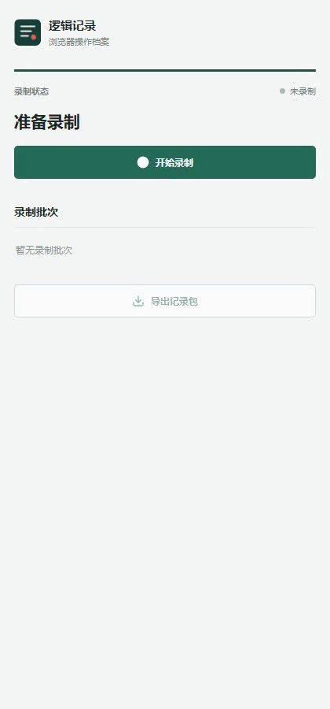
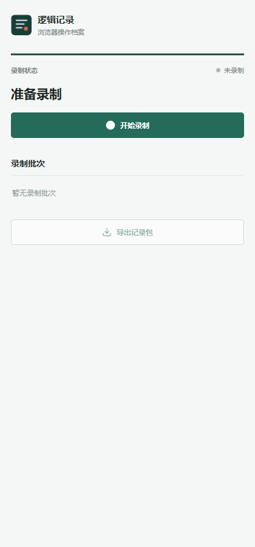
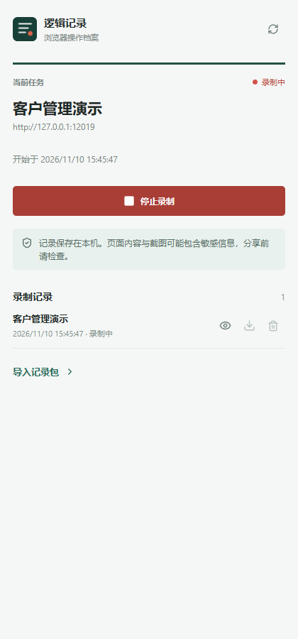
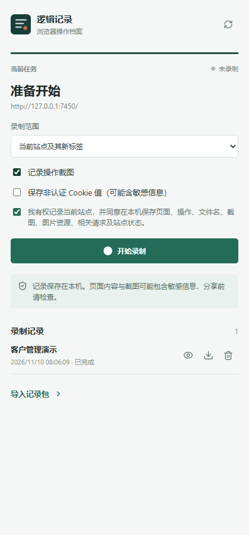

# 逻辑记录 | Logic Recorder

在 Chrome 侧边栏录制已授权的浏览器操作，并将选定批次导出为 ZIP 记录包。

[English](README.en.md) · [安装与使用](docs/插件安装与使用说明.md) · [技术文档](docs/Chrome扩展技术开发文档.md) · [需求文档](docs/Chrome扩展需求梳理.md) · [更新说明](docs/CHANGELOG.md)

> 当前为 **0.1.2 开发验证版**。扩展只记录实际访问并可观察到的内容；浏览器限制、权限、时序和大小限制会造成缺失，不能保证完整还原网站或恢复服务端源码。

## 演示



[观看 MP4](docs/media/workflow.mp4) · [观看 WebM](docs/media/workflow.webm) · [演示素材说明](docs/DEMO.md)

| 准备录制 | 录制中 | 选择批次 |
| :---: | :---: | :---: |
|  |  |  |

演示使用本地虚构数据和隔离的测试浏览器。侧边栏只提供开始录制、停止录制和选择批次导出，不展示录制内容，也不提供插件内查看、导入或复现页面。

## 安装

需要 Chrome 125 或更高版本。可从 [GitHub Releases](https://github.com/copypasteltd/data-collect-extension/releases) 下载发布的 `logic-recorder-chrome-v0.1.2.zip`，解压后在 `chrome://extensions` 开启开发者模式，选择“加载已解压的扩展程序”，并选择包含 `manifest.json` 的解压目录。

也可从源码构建；此方式还需要 Node.js 20 或更高版本和 npm：

```powershell
cd app
npm ci
npm run build
```

打开 Chrome 的 `chrome://extensions`，开启开发者模式，选择“加载已解压的扩展程序”，选择项目中的 `app/dist` 文件夹。点击扩展图标打开侧边栏；更新源码后重新构建并在扩展管理页刷新扩展。

## 使用

1. 打开有权录制的 HTTP 或 HTTPS 网页，点击扩展图标。
2. 在侧边栏点击“开始录制”，在 Chrome 权限提示中授权网页访问。扩展会尝试记录所有已授权的普通网页，包括录制时已打开的页面及随后打开的页面。
3. 正常操作网页，完成后点击“停止录制”。侧边栏关闭后，录制仍由扩展后台继续；浏览器退出可能导致当前批次中断。
4. 在“录制批次”中选择一个已完成或中断的批次，点击“导出记录包”。可切换批次并分别导出；中断批次仅包含已保存的数据。

批次和 ZIP 均保存在本机，扩展不会主动上传记录。卸载扩展可能清除其本地数据，应先导出需要保留的批次。

## 记录内容

插件尽力记录授权范围内的页面、操作、截图、网络请求及响应、Cookie、站点存储和可读取的资源。新记录保留浏览器提供的原值，不对密码、认证字段或截图进行遮挡；原始 DOM 单独保存在页面快照事件中。DOM 是采集时的序列化结果，并非原始 HTTP 字节，也不包含 Shadow DOM 或未反映在属性中的实时表单值。

记录包可能包含密码、登录凭据、个人信息和业务数据。**ZIP 不加密，取得文件的人可以读取这些内容。**只录制已获授权的页面，并妥善保存和传输记录包。旧记录中已经隐藏的值无法恢复。

### ZIP 结构

```text
manifest.json                 批次信息、状态、事件分段与限制
integrity.json                文件大小及 SHA-256 校验清单
timeline/events-00001.jsonl   按事件分段的操作、页面、网络和状态
screenshots/                  已保存的截图
resources/index.json          资源索引
resources/                    已保存的图片、字体等资源
```

事件中的 `page.snapshot.payload.sourceHtml` 是原始 DOM，`html` 是用于隔离展示的快照；`sourceStatus` 标明原始 DOM 是否取得。网络事件通过 `requestId` 关联请求、响应和结束状态。文本响应无法解码时，在大小允许的范围内会保留带 `encoding: "base64"` 的浏览器原始数据及 `textStatus`。ZIP 中的校验只能发现文件变化，不证明来源真实，也不提供加密。

## 使用解析技能

仓库提供 [`$extension-logic-clone`](app/skills/extension-logic-clone/SKILL.md)，用于校验记录包、整理页面和操作证据，并按要求基于已观察流程构建复现项目。技能在插件之外运行，不改变侧边栏功能。解析工具需要 Python 3.9 或更高版本，无需安装额外 Python 库。

也可从 [GitHub Releases](https://github.com/copypasteltd/data-collect-extension/releases) 下载 `extension-logic-clone-v0.1.2.zip`，将其中的 `extension-logic-clone` 文件夹解压到当前用户的 `.codex/skills/` 目录，然后开启新的 Codex 会话。

Windows PowerShell 中，从项目根目录安装到当前用户的 Codex 技能目录：

```powershell
$skillRoot = Join-Path $env:USERPROFILE '.codex\skills'
New-Item -ItemType Directory -Force -Path $skillRoot | Out-Null
$skillTarget = Join-Path $skillRoot 'extension-logic-clone'
if (Test-Path -LiteralPath $skillTarget) { throw '技能目录已存在，请先检查后再更新' }
Copy-Item -LiteralPath '.\app\skills\extension-logic-clone' -Destination $skillTarget -Recurse
```

在 Codex 中开启新会话后，指定 ZIP 和希望保存结果的位置，例如：

```text
$extension-logic-clone 解析 D:\recordings\session.zip，整理已访问页面、操作和接口证据，在 D:\work\reconstruction 中复现已观察流程。
```

也可以直接生成可查询的索引，输出文件必须尚不存在：

```powershell
python .\app\skills\extension-logic-clone\scripts\index_archive.py D:\recordings\session.zip --output D:\work\recording-index.sqlite3
```

索引包含完整原始事件，可能含密码和凭据；请勿将其提交到仓库。详细读取规则、查询示例和限制见[技能使用说明](docs/技能使用说明.md)。

## 能力边界

- 开始前的操作和请求无法补录；受限页面、跨域框架、调试连接中断及浏览器未提供的数据可能缺失。
- 截图受频率、活动标签和时序限制，连续操作可能共用截图或没有截图；画布只尝试保存静态画面。
- 页面快照、原始 DOM、输入、请求体、响应体、数据库和资源均有体积或数量上限，缺口记录在事件及批次信息中。文件内容、缓存响应和数据库中间变化当前不保证采集。
- 已访问路径的记录可供后续分析，但不能据此保证恢复未访问分支、原站源码、服务端逻辑或可直接部署的完整网站。

详细限制和格式见[安装与使用说明](docs/插件安装与使用说明.md)及[技术文档](docs/Chrome扩展技术开发文档.md)。

## 开发与验证

```powershell
cd app
npm ci
npm run build
npm test
npm run test:e2e
npm run test:startup-tabs
npm run test:attach-stop
npm run test:query-parameters
npm run test:response-encoding
npm run test:skill
```

浏览器测试需要 Playwright Chromium，可运行 `npx playwright install chromium`。正式版 Chrome 的 HTTP 页面与扩展错误检查可通过 `CHROME_BIN` 指定 Chrome 可执行文件后运行 `npm run test:chrome-errors`。技能测试需要 Python 3.9+。测试使用本地虚构数据，并关闭其创建的浏览器及临时服务。不使用 Docker 或 WSL。`app/tests/` 中早期查看器相关的测试文件保留作历史参考，不属于当前侧边栏测试入口。
